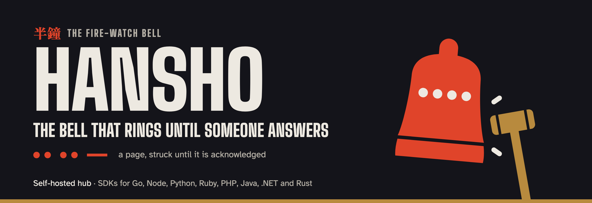

  

  
  
  
  
  

  <a href="https://hansho.app">Website</a> ·
  <a href="https://hansho.app/docs">Docs</a> ·
  <a href="https://hansho.app/try">Try it on your phone</a> ·
  <a href="https://hansho.app/templates">Template builder</a>

# Hansho

Hansho (半鐘, the fire-watch bell) lets any backend reach a specific person's iPhone and Apple Watch: notifications at
five urgency levels, pages that ring like an alarm until someone acknowledges them, Live Activities and home screen
widgets, end-to-end encrypted. Site and docs: [hansho.app](https://hansho.app).

This repository holds the parts you run and call yourself:

| | | License |
|---|---|---|
| [`hub/`](hub/README.md) | The self-hosted server your backend talks to: pairs your users with the app, stores channels, templates and sounds, and delivers messages through Hansho's relay. Image: `ghcr.io/recodive/hansho-hub` | AGPL-3.0 |
| [`sdk/`](sdk/README.md) | Clients for the hub's API in Go, Node/TypeScript, Python, Ruby, PHP, Java/Kotlin, .NET and Rust, plus webhook verification | MIT |

The iPhone and Apple Watch app is in public beta on [TestFlight](https://testflight.apple.com/join/sEQAYCAk). The relay
that forwards encrypted pushes to Apple is run by Hansho at `relay.hansho.app`; it only ever sees sealed tokens and
ciphertext.

## Five strike codes

In Edo, the watchman told the town how close a fire was by how he struck the bell. Hansho's five levels work the same
way, and the sender's channel caps how loud a message may get:

| Level | Strikes | On the phone |
|---|---|---|
| `passive` | ○ | Lands in the inbox, no sound |
| `active` | ● | A normal notification |
| `time-sensitive` | ● ● ● | Breaks through Focus |
| `critical` | ●● ●● ● | Sounds even on silent |
| `page` | ●● ●● ━ | Rings like an alarm until someone acknowledges it, on any of their devices |

## Quickstart

Run a hub (it needs a public HTTPS domain), pair your phone and send a page in about ten minutes:
[hub/README.md](hub/README.md#quickstart-10-minutes), or the [docs](https://hansho.app/docs#quickstart).

    npm install @recodive/hansho
    go get github.com/recodive/hansho/sdk/go

The other SDKs and their install lines: [sdk/README.md](sdk/README.md).

## Licensing

The hub is licensed under the [GNU Affero General Public License v3.0](hub/LICENSE): you can run, change and share it,
and if you offer a changed hub to others over a network, you share those changes under the same license. The SDKs are
[MIT](sdk/LICENSE), so they can go into any codebase, open or closed. Each SDK directory carries its own copy.

## Contributing and security

See [CONTRIBUTING.md](CONTRIBUTING.md) and the [code of conduct](CODE_OF_CONDUCT.md). Please report vulnerabilities privately, as described in
[SECURITY.md](SECURITY.md), not in public issues.
